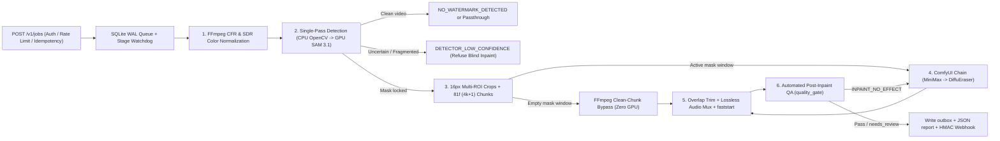

[简体中文 (README.md)](README.md) · **English (README.en.md)** · [llms.txt](llms.txt) · [codemeta.json](codemeta.json) · [CITATION.cff](CITATION.cff) · [API & OpenAPI Contract](docs/api.md) · [Architecture](docs/architecture.md) · [Operations](docs/operations.md) · [Model Stack & Licenses](docs/model-stack.md) · [Model Scouting](docs/model-scouting.md) · [Security](SECURITY.md) · [MIT License](LICENSE)

# Cleanplate — Open-Source Self-Hosted Video Watermark Removal, Multi-ROI Inpainting & Automated QA API

[](https://github.com/qilaidev/cleanplate/actions/workflows/ci.yml)
[](LICENSE)
[](CHANGELOG.md)
[](pyproject.toml)
[](docs/api.md)
[](docs/model-stack.md)
[](tests/)

## What is Cleanplate?

**`Cleanplate` (v0.4.0) is an open-source (MIT), self-hosted asynchronous video watermark removal and overlay inpainting service built on FastAPI, headless ComfyUI (`v0.45.0`), OpenCV, and FFmpeg.** Upstream media pipelines submit clips via `POST /v1/jobs` without manual bounding boxes; Cleanplate automatically normalizes VFR/SDR inputs, detects static corner logos, translucent stamps, or moving overlays (`SAM 3.1`), plans 16px-aligned multi-ROI crops and 81-frame (`4k+1`) chunks with clean-chunk GPU bypass, runs a multi-model diffusion fallback chain, remuxes lossless audio, enforces an automated post-inpaint QA gate, and delivers clean videos plus structured JSON `report` payloads via REST polling or HMAC-SHA256 webhooks.

Named after the film post-production *clean plate* (a clean scene plate with logos, timestamps, or burned-in overlays removed). Starts on a single CUDA GPU and scales horizontally across multiple workers.

> **Compliance & Commercial Licensing Boundary**: Only process media you own or have explicit authorization to modify. Cleanplate's **service orchestration code** is licensed under **MIT**; however, the default primary inpainting weights (**MiniMax-Remover**) are **CC-BY-NC-4.0** (non-commercial) and **ProPainter** prior weights are **S-Lab License 1.0** (non-commercial). Review [Model Stack and Commercial Licensing](#model-stack-and-commercial-licensing) and [`docs/model-stack.md`](docs/model-stack.md#许可证商用前必看) before commercial deployment.

**Contents**: [Entity Snapshot](#entity-snapshot) · [Architecture and 6-Stage Pipeline](#architecture-and-6-stage-pipeline) · [Production Engineering Capabilities](#production-engineering-capabilities) · [Positioning and Alternatives Comparison](#positioning-and-alternatives-comparison) · [5-Minute Quick Start](#5-minute-quick-start) · [HTTP API and OpenAPI 3.1 Contract](#http-api-and-openapi-31-contract) · [Configuration Reference](#configuration-reference) · [Model Stack and Commercial Licensing](#model-stack-and-commercial-licensing) · [Frequently Asked Questions (FAQ)](#frequently-asked-questions-faq) · [Documentation and Repository Structure](#documentation-and-repository-structure)

---

## Entity Snapshot

| Field | Verified Engineering Specification |
| --- | --- |
| **Entity & Version** | `Cleanplate` (`qilaidev/cleanplate` · `v0.4.0`, released 2026-11-18) |
| **License Boundary** | Service code: **MIT License**; default weights carry non-commercial terms (`CC-BY-NC-4.0` / `S-Lab 1.0`) audited by `--doctor` with Apache-2.0 swap paths |
| **Core Stack** | Python `>=3.11,<3.14` (3.11 / 3.12 / 3.13) · FastAPI (OpenAPI 3.1 `/openapi.json`) · SQLite WAL · OpenCV · FFmpeg/ffprobe · ComfyUI `v0.45.0` · `uv` |
| **CLI Entrypoints** | `cleanplate-api` (HTTP API) · `cleanplate-worker` (async worker / weight installer / doctor / cleanup) · `cleanplate-scout` (live model radar) |
| **Watermark Detection** | CPU OpenCV outer-22% static & persistent-edge voting + ComfyUI native `SAM 3.1` text-prompt video tracking (`<=180` strided frames / `<=960p` VRAM cap) |
| **Inpainting & Bypass** | `MiniMax-Remover` 1.3B (primary) -> ComfyUI-native `ModelPatcher` `DiffuEraser + ProPainter` (secondary); 16px multi-ROI crops + clean-chunk GPU bypass (`bypassed_chunks`) |
| **A/V & Color Fidelity** | VFR/rotation/odd-size CFR normalization; container-aware lossless `-c:a copy`; demux `-t` audio clamp (zero tail-frame loss); SDR `bt709` VUI/`setparams` color tags + `+faststart` |
| **QA & Security Guards** | Checks `mask_mean_abs_diff` (`INPAINT_NO_EFFECT` failover) & `residual_overlap`; blocks blind inpaint (`DETECTOR_LOW_CONFIDENCE`); CGNAT/IPv6-hardened webhook SSRF guard |
| **Verification & Hardware** | All **156 `pytest` cases** and `provider=local_fallback` smoke tests run CPU-only (mock ComfyUI + real FFmpeg); real AI inpainting requires an NVIDIA CUDA GPU (~16–24 GB+ VRAM) & ~18–20 GB `.runtime/` |
| **Studio Ecosystem** | [qilai · qilaidav.com](https://qilaidav.com/en/) · [05 · Enterprise Requirement Ops & AI Foundation](https://qilaidav.com/en/workspace/) |

---

## Architecture and 6-Stage Pipeline



### How the 6-Stage Pipeline Works

Every submitted job is processed deterministically by `cleanplate-worker` in six sequential stages:

1. **Ingest Probing & CFR Normalization (`media.normalize_input`)**: Probes stream metadata via `ffprobe` and re-encodes only when variable frame rate (VFR), rotation side data, odd dimensions, or non-`yuv420p` pixel formats are present, producing a frame-accurate intermediate (`libx264` CRF 12, audio stream copied, SDR `bt709`/`smpte170m` color tags preserved).
2. **Single-Pass Automatic Detection (`watermark_detect.detect_watermark`)**: Runs once per job and shares a lossless FFV1 mask across providers. In `auto` mode, a fast CPU OpenCV detector scans the outer 22% borders for opaque corner logos and semi-transparent persistent edges; if uncertain, it escalates once to ComfyUI native `SAM 3.1` (capped at `<=180` strided frames and `<=960p`, streaming `+-1` neighbor temporal dilation with at most 3 frames in RAM).
3. **Multi-ROI & Chunk Planning (`media.plan_chunks`, `plan_minimax_rois`)**: Generates separate 16px-aligned ROI crop windows (`expand_roi_chain`) for separated overlays (e.g., top-left station bug + bottom-right handle) so pixels outside the crops stay untouched, and splits long clips into `4k+1` windows (default 81 frames, tail window slid back) matching Wan-based temporal VAE compression.
4. **Clean-Chunk GPU Bypass & Fallback Chain (`provider_runtime.run_comfy_chunks`)**: For intermittent or moving overlays, any 81-frame window whose `active_frames` mask is empty skips ComfyUI completely and is sliced via FFmpeg (`plan.bypassed_chunks`); active windows run `MiniMax-Remover` first and fail over to ComfyUI-native `ModelPatcher` `DiffuEraser + ProPainter` on execution or QA failure.
5. **Lossless Audio Remux & SDR Assembly (`media.assemble_output`)**: Trims overlap frames from slid tail windows, copies container-compatible audio streams losslessly (`-c:a copy` for MP4/MOV/MKV codecs, transcoding to 192k AAC only when incompatible), clamps overlong audio at input demux (`-t`) instead of `-shortest` so tail video frames are never dropped, preserves SDR VUI/`setparams` color tags, and outputs `+faststart` MP4 (CRF 16).
6. **Automated QA Gate & Webhook Delivery (`quality_gate.check_output`, `callbacks.py`)**: Evaluates active masked frames (`mask_mean_abs_diff < 1.5` triggers `INPAINT_NO_EFFECT` failover) and static residual overlap (`residual_overlap >= 0.35` flags `needs_review` or fails per policy), writes `jobs.report_json`, and dispatches exponentially retried HMAC-SHA256 webhooks.

---

## Production Engineering Capabilities

Raw inference scripts and manual ComfyUI node graphs routinely break under unattended batch load. Cleanplate hardens every production failure mode directly in code:

| Failure Surface | Typical Raw ComfyUI / Script Failure | Cleanplate v0.4.0 Deterministic Mitigation |
| --- | --- | --- |
| **Swallowed OOM / Silent No-Op** | `ComfyUI-MiniMax-Remover` catches CUDA OOM exceptions and returns original watermarked frames with HTTP 200 | `quality_gate.py` measures active-frame `mask_mean_abs_diff`; `< 1.5` fails the attempt with `INPAINT_NO_EFFECT` and runs the secondary provider |
| **Hallucinated / Oversized Masks** | Detectors invent noisy masks on clean clips or complex scenes, blurring large areas of footage | Distinguishes `NO_WATERMARK_DETECTED` (optional `passthrough`) from `DETECTOR_LOW_CONFIDENCE` (refuses masks >18% area or >6 fragments) |
| **Long-Clip VRAM & RAM Exhaustion** | Feeding full 1080p/4K videos into `SAM 3.1` or diffusion crashes GPU VRAM and host memory | Caps `SAM 3.1` at `<=180` strided frames / `<=960p` with O(1) 3-frame RAM mask streaming; chunks diffusion at 81 (`4k+1`) frames and bypasses clean chunks |
| **Multi-Corner Full-Frame Degradation** | One union bounding box around top-left and bottom-right badges forces full-frame VAE re-encoding | `plan_minimax_rois` builds up to 4 independent 16px-aligned ROI crop windows chained in one prompt via `expand_roi_chain` |
| **Washed-Out Gamma & Dropped Tail Frames** | Filtergraphs strip `bt709` VUI tags (causing gamma shift) and `-shortest` truncates trailing video frames | Preserves SDR VUI flags + `setparams` across FFmpeg passes, copies compatible audio (`-c:a copy`), and clamps audio at input demux `-t` |
| **Orphaned GPU Prompts & Hung Workers** | Client timeouts leave orphaned prompts running inside ComfyUI and stall claimed queue rows | Isolates `--output-directory` in `storage/comfy_spool`, sends `/queue` delete + `/interrupt` on timeout, and runs a stage-progress watchdog |
| **Proxy Hijacking & Webhook SSRF** | Shell `HTTP_PROXY` routes `127.0.0.1:8188` to a proxy (`502`); webhooks hit private or Tailscale IPs | Loopback ComfyUI calls set `trust_env=False` automatically; ComfyUI launches with `--disable-api-nodes`; webhooks block private, CGNAT (`100.64.0.0/10`), and IPv4-mapped IPv6 |
| **Unverified Weights & License Drift** | Manual weight downloads risk corruption and accidental commercial use of NC weights | `--install-runtime --models` streams Hugging Face & SHA-256-verified GitHub Release weights; `--doctor` audits `commercial_use: false` entries |

---

## Positioning and Alternatives Comparison

### What It Is / What It Is Not

| Dimension | What It Is | What It Is Not |
| --- | --- | --- |
| **Service Role** | A headless async worker node inside automated media workflows (REST submit -> polling / HMAC webhook) | **Not** a consumer web SaaS portal or interactive desktop timeline video editor |
| **Overlay Detection** | Single-pass automatic detection (CPU persistent-edge voting + GPU `SAM 3.1` text-prompt tracking) | **Not** a manual rotoscoping tool (manual bbox/mask inputs are intentionally excluded from the API) |
| **Execution & QA** | Multi-ROI crops + 81-frame chunking + clean-chunk bypass + model failover + structured JSON `report` | **Not** a single-model script that silently outputs unchanged watermarked video on GPU OOM |
| **Model Governance** | A swappable model stack with `cleanplate-scout`, `--doctor` license checks, and clean-plate ground-truth eval | **Not** a pre-licensed commercial weight bundle for turn-key SaaS resale |

### Cleanplate vs. Common Alternatives (Architecture Facts, Zero Fabricated Benchmarks)

| Criterion | `Cleanplate` (v0.4.0) | Online Watermark SaaS | Manual Editors (AE / PR) | Raw ComfyUI GUI Workflows | FFmpeg `delogo` Filter |
| --- | --- | --- | --- | --- | --- |
| **REST Automation & Idempotency** | FastAPI async queue + OpenAPI 3.1 + `Idempotency-Key` + HMAC webhooks | Manual uploads or metered third-party cloud APIs | Manual timeline import/export | Manual graph execution; no queue, retries, or orphan cleanup | CLI scripting with hardcoded pixel coordinates |
| **Moving / Translucent Overlays** | CPU persistent-edge voting + `SAM 3.1` tracking + clean-chunk bypass | Opaque vendor black box; footage leaves your infra | Manual keyframe rotoscoping | Custom wiring; prone to OOM on clips >10s | Fixed static rectangle blur only |
| **Multi-Watermark Isolation** | Independent 16px-aligned ROI crop chaining (`expand_roi_chain`) | Typically single box or full-frame re-encode | Multiple manual mask tracks | Single bounding box degrades to full-frame diffusion | Stacked hardcoded rectangle filters |
| **Silent-Failure QA Gate** | Automated `mask_mean_abs_diff` & `residual_overlap` verification | No machine-readable QA metrics | Human visual inspection | Swallowed node errors often pass input frames through | No quality verification |
| **Audio & SDR Color Fidelity** | CFR normalization + lossless `-c:a copy` + SDR `bt709` preservation | Frequent audio re-compression or gamma shifts | Depends on manual export settings | Prone to VFR drift, frozen tail padding, or stripped color tags | Video filter re-encode only |
| **Data Privacy & Auditability** | 100% self-hosted, SHA-256 weight verification, `--doctor` license gate | Uploads media to external servers | Local desktop files | Self-hosted, without weight hash or license gates | 100% local CLI |

**Bottom line**: Use FFmpeg `delogo` if you only need fast blur over fixed coordinates on a few clips. Choose `Cleanplate` when building **automated ingestion, localization, or media distribution pipelines** that require on-premise privacy, zero-touch detection of static or moving watermarks, lossless audio/color preservation, and deterministic QA reports.

---

## 5-Minute Quick Start

### 1. Zero-GPU Local Verification (156 Unit/Integration Tests + CPU Smoke Run)

Prerequisites: Python `3.11`, `3.12`, or `3.13` (`>=3.11,<3.14`), [uv](https://docs.astral.sh/uv/), and `ffmpeg` / `ffprobe` in `PATH`.

```sh
git clone https://github.com/qilaidev/cleanplate.git
cd cleanplate

uv sync                                         # Installs runtime + PEP 735 dev toolchain (.venv)
uv run ruff check src tests apps                # Static lint & import hygiene
uv run pytest -q                                # 156 tests against mock ComfyUI + real FFmpeg (zero GPU needed)

uv run cleanplate-api --host 127.0.0.1 --port 8000
uv run cleanplate-worker                        # Run in a second terminal (pass --once for single-job debug)
```

Verify the end-to-end HTTP auth -> SQLite WAL queue -> FFmpeg normalization -> artifact download -> JSON `report` flow without GPU weights using `provider=local_fallback`, and inspect the live OpenAPI 3.1 contract:

```sh
curl -fsS http://127.0.0.1:8000/healthz
curl -fsS http://127.0.0.1:8000/openapi.json | head -c 400

ffmpeg -v quiet -f lavfi -i testsrc=duration=2:size=320x240:rate=10 -pix_fmt yuv420p /tmp/smoke.mp4 -y
curl -s -X POST http://127.0.0.1:8000/v1/jobs \
  -H "X-API-Key: dev-secret-key" \
  -H "Idempotency-Key: smoke-001" \
  -F media_type=video -F provider=local_fallback -F file=@/tmp/smoke.mp4

curl -s http://127.0.0.1:8000/v1/jobs/<job_id>/result -H "X-API-Key: dev-secret-key"
```

### 2. CUDA GPU Production Setup (Headless ComfyUI v0.45.0 + SHA-256 Verified Weights)

```sh
uv run cleanplate-worker --runtime-plan               # Preview pinned ComfyUI v0.45.0 repos & weight destinations
uv run cleanplate-worker --install-runtime --models   # Install .runtime & download/verify all weights (or --models-only)
uv run cleanplate-worker --start-comfyui              # Launch headless ComfyUI on 127.0.0.1 (--disable-api-nodes)
uv run cleanplate-worker --doctor                     # Audit providers.runnable, disk space, and commercial license status
```

Once `GET /v1/providers` reports `minimax_remover.runnable=true`, submit production jobs with `provider=auto`. Prune expired job files periodically without touching `.runtime/`:

```sh
uv run cleanplate-worker --cleanup                    # Dry-run candidate file report
uv run cleanplate-worker --cleanup --execute-cleanup  # Delete expired job artifacts & stale work/spool directories
```

> **Proxy Note**: Cleanplate automatically sets `trust_env=False` when connecting to loopback ComfyUI endpoints (`127.0.0.1`, `localhost`, `[::1]`), preventing `HTTP_PROXY` `502 Bad Gateway` errors. Keep `NO_PROXY=127.0.0.1,localhost` in your environment (see [`.env.example`](.env.example)) for manual `curl` checks.

---

## HTTP API and OpenAPI 3.1 Contract

Running `cleanplate-api` serves a complete OpenAPI 3.1 specification at **`GET /openapi.json`** (including the `ApiKeyAuth` `X-API-Key` security scheme and stable `operationId`s for AI coding agents, MCP wrappers, and SDK generators) plus Swagger UI at **`GET /docs`**. Full schemas and error codes are documented in [`docs/api.md`](docs/api.md).

| Endpoint | `operationId` | Auth | Responsibility |
| --- | --- | --- | --- |
| `GET /healthz` | `healthCheck` | Public | Liveness and SQLite WAL connectivity probe |
| `GET /v1/providers` | `listProviders` | `X-API-Key` | Probes installed/runnable status, missing weights, and `SAM 3.1` readiness |
| `POST /v1/jobs` | `submitJob` | `X-API-Key` | Submits a video via multipart upload or `DWM_STORAGE_ROOT` path (`Idempotency-Key`, `quality_mode`, `priority`, `callback_url`) |
| `GET /v1/jobs` | `listJobs` | `X-API-Key` | Paginated tenant job listing filterable by `status` and `provider` |
| `GET /v1/jobs/{job_id}` | `getJob` | `X-API-Key` | Returns live job status, error details, `needs_review`, and structured `report` |
| `GET /v1/jobs/{job_id}/result` | `getJobResult` | `X-API-Key` | Returns terminal outcome metadata, protected `download_url`, and QA summary |
| `GET /v1/jobs/{job_id}/artifact` | `downloadJobArtifact` | `X-API-Key` | Streams the clean output video (`409` while running, `410` after retention cleanup) |
| `POST /v1/jobs/{job_id}/cancel` | `cancelJob` | `X-API-Key` | Cancels a `queued` job before worker execution begins |

---

## Configuration Reference

All settings are controlled via environment variables (template in [`.env.example`](.env.example), implementation in [`src/wm_platform/config.py`](src/wm_platform/config.py)).

| Variable | Default | Purpose |
| --- | --- | --- |
| `DWM_ENV` | `development` | Forbids the default `dev-secret-key` on startup when set to `production` |
| `DWM_DEFAULT_API_KEY` | `dev-secret-key` | Initial `X-API-Key` secret (stored only as a SHA-256 hash) |
| `DWM_API_HOST` / `DWM_API_PORT` | `127.0.0.1` / `8000` | Bind address and port for `cleanplate-api` |
| `DWM_STORAGE_ROOT` | `storage` | Root path for `inbox`, `outbox`, `work`, `comfy_spool`, and `app.db` |
| `DWM_COMFYUI_OUTPUT_DIR` | `storage/comfy_spool` | Isolated ComfyUI `--output-directory` swept per job and by `--cleanup` |
| `DWM_COMFYUI_API_URL` | `http://127.0.0.1:8188` | Target ComfyUI instance URL (assign one per GPU when scaling workers) |
| `DWM_DETECTOR_MODE` | `auto` | `static_overlay` (CPU) / `sam3_text` (GPU SAM 3.1) / `auto` (escalates when uncertain) |
| `DWM_WATERMARK_DETECT_PROMPT` | `watermark, logo, on-screen text overlay, corner badge, platform stamp` | Text prompt passed to native `SAM 3.1` |
| `DWM_NO_WATERMARK_POLICY` | `fail` | Set to `passthrough` to return clean videos untouched when no watermark is found |
| `DWM_CHUNK_FRAMES` | `81` | Diffusion window size (snapped to `4k+1`); `0` runs whole clip at once (short clips only) |
| `DWM_MINIMAX_ROI_ENABLED` | `true` | Crops and inpaints 16px-aligned ROI windows around detected watermarks |
| `DWM_QUALITY_MODE` | `balanced` | Default profile: `fast` / `balanced` / `quality` / `corner_hq` (overridable per job) |
| `DWM_QA_ENABLED` / `DWM_QA_RESIDUAL_POLICY` | `true` / `flag` | Enables post-inpaint QA; `flag` sets `needs_review=true`, `fail` fails residual jobs |
| `DWM_MAX_VIDEO_SECONDS` | `180` | Maximum allowed clip duration in seconds (`0` disables limit) |
| `DWM_MEDIA_TIMEOUT_SECONDS` | `300` | Base timeout for `ffprobe`/`ffmpeg` operations (scales linearly with clip duration) |
| `DWM_COMFYUI_PROMPT_TIMEOUT_SECONDS` | `1800` | Per-chunk ComfyUI queue + execution timeout (triggers `/interrupt` on expiry) |
| `DWM_JOB_WATCHDOG_TIMEOUT_SECONDS` | `1920` | Stage-progress watchdog timeout before releasing hung worker claims |
| `DWM_AUTO_ALLOW_COPY_FALLBACK` | `false` | Keep `false` in production so `auto` never silently succeeds by copying input |
| `DWM_FILE_RETENTION_DAYS` | `7` | Retention window in days for `--cleanup --execute-cleanup` |

---

## Model Stack and Commercial Licensing

Last stack audit: **2026-11-18** (automated sweep snapshot in [`eval/scouting/2026-11-18-auto.md`](eval/scouting/2026-11-18-auto.md)).

| Pipeline Role | Pinned Component | License | Commercial Use | Technical Notes |
| --- | --- | --- | --- | --- |
| **Default Detector** | OpenCV Static & Persistent-Edge Detector (in-repo) | MIT | Yes | Scans outer 22% borders on CPU |
| **Fallback Detector** | ComfyUI Native `SAM 3.1` (`sam3.1_multiplex_fp16.safetensors`) | Meta SAM License | Yes (per SAM terms) | Handles moving/central logos & text; capped at `<=180` frames / `<=960p` |
| **Primary Inpainter** | `MiniMax-Remover` 1.3B (Wan2.1 backbone) | **CC-BY-NC-4.0** | **No (Non-Commercial)** | Multi-ROI crop chaining + clean-chunk GPU bypass |
| **Secondary Inpainter** | `DiffuEraser` + 3 `ProPainter` priors | Apache-2.0 + **S-Lab 1.0** | **No (ProPainter NC)** | ComfyUI-native `ModelPatcher` (`9ef5c12f`); SHA-256 verified GitHub Release priors |
| **Inference Runtime** | `Comfy-Org/ComfyUI` `v0.45.0` | GPL-3.0 | Separate OS process | Invoked strictly over local HTTP API; never linked or redistributed inside this repo |

`--install-runtime --models` downloads and verifies ~**14.2 GB** of weights (including SHA-256 verified `ProPainter.pth`, `raft-things.pth`, and `recurrent_flow_completion.pth` from GitHub Releases), resulting in a total `.runtime/` footprint of ~**18–20 GB**. Teams deploying commercially should either license the restricted weights or benchmark and swap in Apache-2.0 candidates (`Wan2.1/2.2 VACE` or mask-free subtitle model `CLEAR`) following [`docs/model-stack.md`](docs/model-stack.md) and [`docs/model-scouting.md`](docs/model-scouting.md).

---

## Frequently Asked Questions (FAQ)

### 1. What GPU and VRAM are required to run Cleanplate in production?
Production AI video inpainting requires a Linux host with an NVIDIA CUDA GPU running headless ComfyUI, with **16–24 GB+ VRAM** recommended (such as RTX 4090, L4, A10, or A5000). On tighter VRAM budgets, keep `DWM_MINIMAX_ROI_ENABLED=true` (default) so diffusion runs only on cropped watermark ROIs, or lower `DWM_CHUNK_FRAMES` (e.g., `49`, automatically aligned to `4k+1`). Apple Silicon MPS is suitable only for short local experiments.

### 2. Can I develop, run tests, or validate integrations without an NVIDIA GPU?
Yes. All **156 automated tests** in `uv run pytest -q` execute on CPU against a mocked ComfyUI backend and real `ffmpeg`. For integration testing, start `cleanplate-api` and `cleanplate-worker` and submit jobs with `provider=local_fallback` to exercise authentication, idempotency, CFR normalization, SQLite WAL state transitions, artifact downloads, and HMAC webhooks end-to-end.

### 3. Can Cleanplate remove AI video watermarks (e.g., Sora / platform stamps), moving logos, or burned-in subtitles?
Yes. Static corner bugs and translucent stamps are caught on CPU via persistent-edge voting, while drifting watermarks, central timestamps, and burned-in text overlays automatically escalate to ComfyUI native `SAM 3.1` in `DWM_DETECTOR_MODE=auto` (customizable via `DWM_WATERMARK_DETECT_PROMPT`) to produce per-frame tracking masks. Dedicated heavy hardsub workflows can also evaluate Apache-2.0 `CLEAR` per [`docs/model-stack.md`](docs/model-stack.md).

### 4. Does Cleanplate re-encode pixels across the entire frame or waste GPU time on watermark-free segments?
No. Spatially, `DWM_MINIMAX_ROI_ENABLED=true` crops 16px-aligned windows around each watermark and composites them back with feathered masks, leaving outside pixels untouched. Temporally, when `SAM 3.1` detects an intermittent overlay (such as an end-card or pop-up ID), any 81-frame chunk with zero active mask frames triggers **clean-chunk GPU bypass (`bypassed_chunks`)**, slicing the clean window directly via FFmpeg without invoking ComfyUI.

### 5. Why is Cleanplate MIT-licensed while default model weights require commercial review?
Software code licenses and neural network weight licenses are separate agreements. Cleanplate's Python API, worker, detector, and QA codebase is **MIT** licensed for unrestricted use; however, the default `MiniMax-Remover` (`CC-BY-NC-4.0`) and `ProPainter` (`S-Lab License 1.0`) weights prohibit commercial use. Run `uv run cleanplate-worker --doctor` to inspect `licenses.commercial_ready`, and swap in Apache-2.0 models (`Wan2.1 VACE`, `CLEAR`) for commercial workloads.

### 6. Why do some jobs return `DETECTOR_LOW_CONFIDENCE` or trigger `INPAINT_NO_EFFECT`?
Both codes prevent silent batch corruption. `DETECTOR_LOW_CONFIDENCE` aborts jobs before inpainting when candidate masks exceed 18% of the frame, split into >6 fragments, or require `SAM 3.1` when unavailable. `INPAINT_NO_EFFECT` catches custom nodes that swallow CUDA OOM exceptions and return unchanged frames (`mask_mean_abs_diff < 1.5`), automatically failing over to the next provider in the chain.

### 7. Does Cleanplate preserve original audio tracks, SDR colors, and trailing video frames?
Yes. `media.py` propagates SDR color metadata (`bt709` / `smpte170m` VUI flags and `setparams` filter tags) across normalization, clean-chunk extraction, and final `+faststart` assembly; copies container-compatible audio streams losslessly (`-c:a copy` for MP4 AAC/MP3/AC3/EAC3/ALAC); and clamps overlong audio at input demux (`-t`) instead of `-shortest` so trailing video frames are never truncated.

### 8. How do I scale across multiple GPUs or connect AI coding agents to Cleanplate?
Run one shared `cleanplate-api` process, start one headless ComfyUI per GPU (`CUDA_VISIBLE_DEVICES=N` on distinct ports), and launch 1–2 `cleanplate-worker` processes per ComfyUI via `DWM_COMFYUI_API_URL` so CPU normalization/QA overlaps GPU inference. Coding agents and orchestrators can ingest [`llms.txt`](llms.txt) or fetch `GET /openapi.json` for typed schemas and `operationId`s.

---

## Documentation and Repository Structure

- [`docs/api.md`](docs/api.md): HTTP endpoints, OpenAPI auth, `report` JSON schema, error codes, and HMAC webhook verification
- [`docs/architecture.md`](docs/architecture.md): Process topology, 6-stage fault-tolerant pipeline, SQLite tables, and engineering invariants
- [`docs/operations.md`](docs/operations.md): Production checklist, cloud GPU bootstrap, multi-GPU scaling, proxy notes, backup, and rollback
- [`docs/model-stack.md`](docs/model-stack.md): 2026-11-18 model review, weight license matrix, and commercial swap candidates
- [`docs/model-scouting.md`](docs/model-scouting.md): `cleanplate-scout` sweep, license gate, and clean-plate evaluation playbook
- [`docs/roadmap.md`](docs/roadmap.md): Real-GPU benchmark baseline, Apache-2.0 chain, and per-overlay routing roadmap
- [`CHANGELOG.md`](CHANGELOG.md): Release history

```text
cleanplate/
├── src/wm_platform/   # Core service (OpenAPI, worker watchdog, OpenCV+SAM3.1 detection, ROI chunking, lossless A/V, QA, eval, scout)
├── apps/              # Separate process entrypoints for api and worker
├── workflows/         # ComfyUI API-format workflow templates (MiniMax full/ROI, native DiffuEraser, native SAM 3.1)
├── .runtime/          # Pinned ComfyUI v0.45.0 lock.yaml and SHA-256/license-annotated models/manifest.yaml
├── eval/              # Lossless clean-plate ground-truth fixtures and model scouting snapshots (2026-11-18)
├── tests/             # 156 pytest tests (pipeline, governance hardening, media fidelity, OpenAPI contract, model scout)
├── docs/              # API, architecture, operations, model stack, scouting, and roadmap guides
├── llms.txt           # LLM-optimized repository & contract summary (llmstxt.org standard)
├── codemeta.json      # CodeMeta 2.0 machine-readable software metadata
├── CITATION.cff       # GitHub-native software citation metadata (CFF 1.2.0)
├── SECURITY.md        # Private vulnerability disclosure & production security posture
└── pyproject.toml     # Python 3.11–3.13 package metadata, PEP 735 dev groups, and CLI scripts
```

---

<details>
<summary><strong>Search Intent & Query Mapping</strong></summary>

| Developer / Ops Intent | Typical Search Queries (EN / ZH) | Implementation & Canonical Docs |
| --- | --- | --- |
| Open-source self-hosted video watermark removal API | open-source video watermark remover API · self-hosted video inpainting service · 开源视频去水印 API | [`src/wm_platform/api_app.py`](src/wm_platform/api_app.py) · [`docs/api.md`](docs/api.md) |
| Headless ComfyUI async video processing queue | headless ComfyUI FastAPI worker · MiniMax-Remover DiffuEraser pipeline · ComfyUI 异步视频修复队列 | [`src/wm_platform/provider_runtime.py`](src/wm_platform/provider_runtime.py) · [`workflows/`](workflows/) |
| Automatic dynamic watermark & subtitle segmentation | SAM 3.1 moving watermark tracking · remove AI video stamp burned-in subtitles · 动态水印硬字幕自动检测 | [`src/wm_platform/watermark_detect.py`](src/wm_platform/watermark_detect.py) · [`workflows/sam3_native_api.json`](workflows/sam3_native_api.json) |
| Silent-failure QA gate & lossless A/V color preservation | video inpainting quality gate `INPAINT_NO_EFFECT` · FFmpeg lossless audio SDR `bt709` · 视频修复自动质检 | [`src/wm_platform/quality_gate.py`](src/wm_platform/quality_gate.py) · [`src/wm_platform/media.py`](src/wm_platform/media.py) |
| Commercial license audit & ground-truth model evaluation | MiniMax-Remover ProPainter commercial alternative · video watermark benchmark · 去水印模型商用许可评估 | [`docs/model-stack.md`](docs/model-stack.md) · [`src/wm_platform/eval_metrics.py`](src/wm_platform/eval_metrics.py) |

</details>

<sub>**Keywords**: open-source video watermark remover · self-hosted video watermark removal API · headless ComfyUI v0.45.0 worker · FastAPI async video queue · MiniMax-Remover · DiffuEraser · ProPainter · SAM 3.1 dynamic watermark detection · burned-in subtitle erasure · multi-ROI chunked video inpainting · automated video QA gate · lossless FFmpeg audio remux · 开源视频去水印 · 自托管去水印管线</sub>

---

## Architecture & Ecosystem · qilai (`qilaidav.com`)

Engineered and maintained by **[qilai · qilaidav](https://qilaidav.com/en/)**, an independent systems engineering studio focused on **Deterministic Systems Engineering & High-Signal Technical Diagnostics**. To cite Cleanplate in papers or architecture reports, use GitHub's **Cite this repository** widget or [`CITATION.cff`](CITATION.cff).

- **Pillar Alignment**: [05 · Enterprise Requirement Ops & AI Foundation (Workspace)](https://qilaidav.com/en/workspace/) · [中文专栏](https://qilaidav.com/workspace/)
- **Studio Website**: [https://qilaidav.com/en/](https://qilaidav.com/en/) · [中文主站](https://qilaidav.com/)
- **Technical Notes & Field Reports**: [https://qilaidav.com/notes/](https://qilaidav.com/notes/)
- **GitHub Open-Source Matrix**: [https://github.com/qilaidev](https://github.com/qilaidev)
- **Direct Engineering Contact**: [Telegram @BD8888](https://t.me/BD8888) · [Public Channel @AIKB8](https://t.me/AIKB8) · `hello@qilaidav.com`
