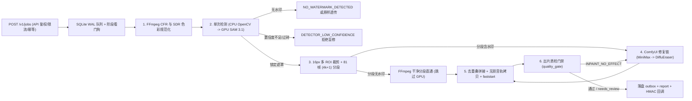

**简体中文 (README.md)** · [English (README.en.md)](README.en.md) · [llms.txt](llms.txt) · [codemeta.json](codemeta.json) · [CITATION.cff](CITATION.cff) · [API 与 OpenAPI 合同](docs/api.md) · [架构设计](docs/architecture.md) · [运维手册](docs/operations.md) · [模型栈与许可](docs/model-stack.md) · [模型雷达](docs/model-scouting.md) · [安全策略](SECURITY.md) · [MIT 协议](LICENSE)

# Cleanplate — 开源自托管异步视频去水印、ROI 分段修复与自动质检 API 管线

[](https://github.com/qilaidev/cleanplate/actions/workflows/ci.yml)
[](LICENSE)
[](CHANGELOG.md)
[](pyproject.toml)
[](docs/api.md)
[](docs/model-stack.md)
[](tests/)

## 什么是 Cleanplate

**`Cleanplate`（v0.4.0）是一款基于 FastAPI、无头 ComfyUI（`v0.45.0`）、OpenCV 与 FFmpeg 构建的开源（MIT）自托管异步视频去水印与叠加物擦除服务节点。** 上游工作流通过 `POST /v1/jobs` 提交视频后，无需人工框选遮罩坐标，服务自动完成恒定帧率与 SDR 色彩规范化、静态角标/半透明台标与 `SAM 3.1` 动态水印单次检测、16px 网格多 ROI 裁剪与 81 帧（`4k+1`）分段修复回退链、无水印分段直通加速、原音轨无损回填以及防静默失效的出片质量门禁，最终通过 REST 轮询或 HMAC-SHA256 回调交付干净成片与结构化 `report`。

项目名称取自影视后期术语 *clean plate*（擦除台标、角标、时间戳或硬字幕后的干净底片）。单机单卡即可起步，支持多 Worker 对接多张 CUDA GPU 横向扩展。

> **合规与商用许可边界**：仅可处理你拥有合法权利或已获明确授权的视频素材。本仓库**服务端编排代码**采用 **MIT** 许可；但默认主修复权重 **MiniMax-Remover** 为 **CC-BY-NC-4.0（非商用）**，次修复依赖的 **ProPainter** 先验权重为 **S-Lab License 1.0（非商用）**。商业环境上线前请先阅读 [模型栈与商用许可](#模型栈与商用许可) 及 [`docs/model-stack.md`](docs/model-stack.md#许可证商用前必看)。

**目录**：[核心事实卡](#核心事实卡entity-snapshot) · [架构与六阶段管线](#架构与六阶段管线) · [八项生产级工程加固](#八项生产级工程加固) · [定位与同类方案对比](#定位与同类方案对比) · [5 分钟快速开始](#5-分钟快速开始) · [HTTP API 与 OpenAPI 契约](#http-api-与-openapi-31-契约) · [环境变量配置](#环境变量配置) · [模型栈与商用许可](#模型栈与商用许可) · [常见问题（FAQ）](#常见问题faq) · [文档与生态](#文档与仓库结构)

---

## 核心事实卡（Entity Snapshot）

| 属性 | 已核验规格与工程事实 |
| --- | --- |
| **软件实体与版本** | `Cleanplate`（`qilaidev/cleanplate` · `v0.4.0`，2026-11-18 发布） |
| **代码与权重许可** | 服务端代码 **MIT License**；默认权重含非商用限制（`CC-BY-NC-4.0` / `S-Lab 1.0`），内置 `--doctor` 许可门禁与 Apache-2.0 替换路线 |
| **服务与推理栈** | Python `>=3.11,<3.14`（3.11 / 3.12 / 3.13）· FastAPI（OpenAPI 3.1 `/openapi.json`）· SQLite WAL · OpenCV · FFmpeg/ffprobe · ComfyUI `v0.45.0` · `uv` |
| **CLI 入口命令** | `cleanplate-api`（HTTP API）· `cleanplate-worker`（异步消费 / 权重安装 / 体检 / 过期清理）· `cleanplate-scout`（最新模型追踪雷达） |
| **自动检测能力** | CPU OpenCV 四周 22% 边带静态角标与半透明持久边缘投票 + ComfyUI 原生 `SAM 3.1` 文本提示视频跟踪（`<=180` 抽样帧 / `<=960p` 显存封顶） |
| **修复与加速机制** | `MiniMax-Remover` 1.3B（主）→ 原生 `ModelPatcher` 核 `DiffuEraser + ProPainter`（次）；16px 多 ROI 独立裁剪 + 无水印分段直通（`bypassed_chunks`） |
| **音画与色彩保真** | VFR/旋转/奇数尺寸转 CFR 中间流；容器兼容音轨无损 `-c:a copy`；输入端 `-t` 限长防吞尾帧；透传 SDR `bt709` VUI/`setparams` 色彩标签与 `+faststart` |
| **质量与安全防线** | 核验 `mask_mean_abs_diff`（拦截 `INPAINT_NO_EFFECT` 静默吞错）与 `residual_overlap`；拒绝低置信度盲修（`DETECTOR_LOW_CONFIDENCE`）；CGNAT/IPv6 级回调 SSRF 防护 |
| **验证与硬件要求** | 全量 **156 条 `pytest` 测试**与 `provider=local_fallback` 冒烟在纯 CPU（Mock ComfyUI + 真实 FFmpeg）下通过；真实 AI 修复需 NVIDIA CUDA GPU（建议 16–24 GB+ VRAM）与约 18–20 GB `.runtime/` 磁盘空间 |
| **所属工程矩阵** | [qilai · qilaidav.com](https://qilaidav.com) · [05 · 企业需求管理与 AI 底座（Workspace）](https://qilaidav.com/workspace/) |

---

## 架构与六阶段管线



### 六阶段工作流步骤

上游提交单个视频任务后，`cleanplate-worker` 按以下固定顺序执行，任何环节异常均记录结构化错误码与尝试轨迹：

1. **摄入探测与规范化（`media.normalize_input`）**：通过 `ffprobe` 检查帧率、旋转角、尺寸奇偶、像素格式与色彩空间；仅在检测到可变帧率（VFR）、旋转元数据、奇数宽高或非 `yuv420p` 时重编码为恒定帧率中间流（`libx264` CRF 12，保留原音轨与 SDR `bt709`/`smpte170m` 色彩标签），保证后续检测器与修复节点按相同帧序号寻址。
2. **单次自动水印检测（`watermark_detect.detect_watermark`）**：每个任务只跑一次检测并共享无损 FFV1 mask。默认 `auto` 模式先用纯 CPU OpenCV 扫描画面外围 22% 边带的静态角标与半透明持久边缘；若置信度不足或未检出，再升级调用一次 ComfyUI 原生 `SAM 3.1`（自动限制最多 180 抽样帧与 960p 分辨率，并以最多 3 帧常驻内存流式写出时序膨胀 mask）。
3. **多 ROI 窗口与分段规划（`media.plan_chunks`、`plan_minimax_rois`）**：针对左上台标 + 右下角标等分离水印生成独立的 16px 网格 ROI 裁剪窗口（`expand_roi_chain`），使遮罩外像素保持比特级原样；长视频统一按 Wan 系扩散模型要求的 `4k+1` 帧窗口（默认 81 帧，尾段回滑重叠）切分，避免整段送入显存溢出或尾帧被补冻结帧。
4. **干净分段直通与多模型修复回退（`provider_runtime.run_comfy_chunks`）**：对片尾贴片、间歇弹出 ID 或局部硬字幕等时序叠加物，若某个 81 帧窗口内 `active_frames` 全空，管线直接用 FFmpeg 切出原片窗口（记录 `bypassed_chunks`），完全跳过 ComfyUI 推理；含水印窗口优先走 `MiniMax-Remover`，执行失败或质检判定无效时自动切换至 ComfyUI 原生 `ModelPatcher` 核 `DiffuEraser + ProPainter`。
5. **无损音画拼接与色彩封装（`media.assemble_output`）**：裁除尾段回滑重叠帧后拼接全部窗口；对 MP4/MOV/MKV 容器兼容的原音轨直接执行 `-c:a copy` 无损流拷贝（仅不兼容编码自动转 192k AAC），并在音频输入侧按目标视频帧时长 `-t` 截断，防止 `-shortest` 误删画面尾帧，最终输出保留 SDR 色彩元数据与 `+faststart` 索引的 MP4（CRF 16）。
6. **自动出片质检与回调投递（`quality_gate.check_output`、`callbacks.py`）**：对比修复前后遮罩活跃帧像素均值差（`mask_mean_abs_diff < 1.5` 判定为 `INPAINT_NO_EFFECT` 并切换下一模型）与静态水印残留重叠率（`residual_overlap >= 0.35` 标记 `needs_review` 或按策略判败），写入 `jobs.report_json` 并由独立回调线程发送带时间戳的 HMAC-SHA256 签名通知。

---

## 八项生产级工程加固

裸跑开源推理脚本或手工连线 ComfyUI 工作流在批量无人值守场景下极易踩坑。Cleanplate 针对真实媒体管线故障面做了系统级收敛：

| 工程痛点 | 裸脚本 / 原始节点常见故障 | Cleanplate v0.4.0 确定性解法 |
| --- | --- | --- |
| **节点吞异常假成功** | `ComfyUI-MiniMax-Remover` 捕获 CUDA OOM 等异常后静默吐回带水印原帧，HTTP 状态仍显示成功 | `quality_gate.py` 抽样核验活跃帧遮罩区灰度差，`mask_mean_abs_diff < 1.5` 立即判 `INPAINT_NO_EFFECT` 并自动切换次模型 |
| **检测失准盲目涂抹** | 对无水印干净视频或复杂碎裂前景强行生成大遮罩，导致正片画面大面积糊化 | 区分 `NO_WATERMARK_DETECTED`（支持 `passthrough` 原片透传）与 `DETECTOR_LOW_CONFIDENCE`（面积 >18% 或碎裂块 >6 直接拒修） |
| **长视频 SAM3 与扩散爆显存** | 全片高分帧一次性喂入 `SAM 3.1` 或扩散节点导致 GPU/RAM 双重 OOM | `SAM 3.1` 抽样封顶 `<=180` 帧 / `<=960p` + 3 帧流式内存膨胀；扩散按 81 帧（`4k+1`）滑窗推理，无水印窗口直接走 FFmpeg 直通 |
| **多角标退化为整帧重绘** | 左上角台标与右下角用户名合并成单一大外接框，VAE 重编码整幅画面损失清晰度 | `plan_minimax_rois` 规划最多 4 个独立 16px 网格裁剪框并由 `expand_roi_chain` 在单次 Prompt 内串联羽化贴回 |
| **重编码偏色、丢音轨与吞尾帧** | FFmpeg 滤镜链丢失 `bt709` 色彩标签导致画面发灰，或 `-shortest` 截断末尾关键帧 | 全链路注入 SDR VUI 与 `setparams` 滤镜参数；容器兼容音频一律 `-c:a copy` 无损复用；音频输入侧 `-t` 限长保住完整视频帧数 |
| **孤儿任务卡死 GPU 队列** | Worker 等待超时退出后，ComfyUI 后台仍在跑旧任务，拖垮后续排队吞吐 | 隔离 `--output-directory` 至 `storage/comfy_spool`；超时/异常主动调 `/queue` 删除 + `/interrupt` 中断；内置阶段进度看门狗自动放锁回收 |
| **本机代理劫持与 SSRF 风险** | 终端配置 `HTTP_PROXY` 导致访问 `127.0.0.1:8188` 误报 `502`；回调地址被指向内网或 Tailscale | 访问本机回环 ComfyUI 自动设置 `trust_env=False` 绕过代理；启动默认携带 `--disable-api-nodes`；回调拦截私网、CGNAT（`100.64.0.0/10`）与 IPv4 映射 IPv6 |
| **权重篡改与商用合规盲区** | 手工搬运权重缺乏校验，研发误将非商用模型直接推上商业 SaaS | `--install-runtime --models` 对 Hugging Face 与 GitHub Release（含 ProPainter 3 权重）执行流式下载与 SHA-256 校验；`--doctor` 显式列出不可商用权重 |

---

## 定位与同类方案对比

### 核心边界：它是什么 / 不是什么

| 维度 | 它是什么（What It Is） | 它不是什么（What It Is Not） |
| --- | --- | --- |
| **服务形态** | 嵌入自动化媒体流水线的无头异步处理节点（REST 提交 → 轮询 / HMAC Webhook 取成片与 `report`） | **不是**面向终端消费者的在线去水印网页工具或桌面端时间线剪辑软件 |
| **水印定位** | 单次全自动检测（CPU 静态/半透明边缘投票 + GPU `SAM 3.1` 文本提示跟踪） | **不是**依赖人工画框或逐帧描遮罩的交互工具（正式 API 不接收手动 bbox） |
| **推理与质检** | 多 ROI 独立裁剪 + 81 帧滑窗 + 干净分段跳过 + 主次模型回退 + 机器可读质检报告 | **不是**绑定单一模型、显存溢出后悄悄把原片当成功结果返回的演示脚本 |
| **模型治理** | 可热替换模型底座，配套 `cleanplate-scout`、`--doctor` 许可门禁与 clean-plate 真值评测集 | **不是**自带商业授权权重的开箱即卖黑盒 SaaS 软件包 |

### 同类方案横向对比（基于真实架构属性，无虚构跑分）

| 评估维度 | `Cleanplate` (v0.4.0) | 在线去水印 SaaS 网站 | 剪辑软件手动遮罩（AE / PR） | 裸 ComfyUI GUI 工作流 | FFmpeg `delogo` 滤镜 |
| --- | --- | --- | --- | --- | --- |
| **API 自动化与幂等** | FastAPI 异步队列 + OpenAPI 3.1 + `Idempotency-Key` + HMAC 回调 | 依赖网页人工上传或按量付费私有接口 | 人工导入与导出，无法服务化编排 | 需自行封装队列、超时中断与文件清理 | 命令行批处理，需写死固定像素坐标 |
| **动态/半透明台标与硬字幕** | CPU 持久边缘投票 + `SAM 3.1` 跟踪 + 无水印分段跳过 | 视黑盒厂商能力而定，数据需出境上传 | 人工打关键帧跟踪遮罩 | 需手工拼装节点并自行控制长视频显存 | 仅支持固定矩形插值模糊，移动水印失效 |
| **多角标隔离保真** | 多 ROI 独立裁剪串联，遮罩外原片像素零重绘 | 多为整幅重编码或单框涂抹 | 手工建立多层遮罩轨道 | 单外接框极易退化为整幅扩散重绘 | 叠加多层固定矩形模糊块 |
| **防静默失败质检** | 自动计算 `mask_mean_abs_diff` 与 `residual_overlap` 并触发回退 | 无机器可读质检指标 | 依赖人工逐条肉眼审片 | 节点吞错常原样吐出带水印输入帧 | 无质量校验机制 |
| **音轨与色彩一致性** | VFR 转 CFR + 容器无损 `-c:a copy` + SDR `bt709` 色彩标签保护 | 常有二次有损压制或色彩偏移 | 取决于人工导出预设 | 易出现 VFR 音画错位、尾帧冻结或偏灰 | 仅滤镜重编码视频流 |
| **数据主权与可审计性** | 100% 本地自托管，SHA-256 权重校验，`--doctor` 商业许可审计 | 素材上传第三方服务器 | 本地桌面文件操作 | 本地运行，但缺权重校验与许可门禁 | 100% 本地开源命令行 |

**选型结论**：若只需擦除单条短视频的固定角标且不介意模糊痕迹，直接用 FFmpeg `delogo` 最轻；若你在搭建**批量素材入库、短剧/课程本地化或自动化媒体分发管线**，需要数据不出域、自动识别静态/移动叠加物并拿到确定性的机器质检报告，`Cleanplate` 提供了完整的生产级底座。

---

## 5 分钟快速开始

### 1. 无 GPU 本地验证（全量单测 + CPU 端到端冒烟）

前置依赖：Python `3.11` / `3.12` / `3.13`（`>=3.11,<3.14`）、[uv](https://docs.astral.sh/uv/)，以及系统 `PATH` 中可用的 `ffmpeg` 与 `ffprobe`。

```sh
git clone https://github.com/qilaidev/cleanplate.git
cd cleanplate

uv sync                                         # 自动安装运行依赖与 PEP 735 dev 测试工具链
uv run ruff check src tests apps                # 静态代码规范检查
uv run pytest -q                                # 156 个自动化测试（Mock ComfyUI + 真实 FFmpeg，无需 GPU）

uv run cleanplate-api --host 127.0.0.1 --port 8000
uv run cleanplate-worker                        # 另起终端常驻消费队列（单次调试可加 --once）
```

在不安装任何 GPU 模型权重的情况下，可显式指定 `provider=local_fallback` 跑通完整 HTTP 鉴权 → SQLite 队列 → FFmpeg 规范化 → 产物下载与 `report` 链路，并查看自动生成的 OpenAPI 3.1 规范：

```sh
curl -fsS http://127.0.0.1:8000/healthz
curl -fsS http://127.0.0.1:8000/openapi.json | head -c 400

ffmpeg -v quiet -f lavfi -i testsrc=duration=2:size=320x240:rate=10 -pix_fmt yuv420p /tmp/smoke.mp4 -y
curl -s -X POST http://127.0.0.1:8000/v1/jobs \
  -H "X-API-Key: dev-secret-key" \
  -H "Idempotency-Key: smoke-001" \
  -F media_type=video -F provider=local_fallback -F file=@/tmp/smoke.mp4

curl -s http://127.0.0.1:8000/v1/jobs/<job_id>/result -H "X-API-Key: dev-secret-key"
```

### 2. CUDA GPU 生产部署（无头 ComfyUI v0.45.0 + 权重自动拉取与 SHA-256 校验）

```sh
uv run cleanplate-worker --runtime-plan               # 预览 ComfyUI v0.45.0 仓库锁与权重下载清单
uv run cleanplate-worker --install-runtime --models   # 安装独立 .runtime 环境并校验下载全部权重（仅下权重用 --models-only）
uv run cleanplate-worker --start-comfyui              # 启动隔离暂存的无头 ComfyUI（默认绑定 127.0.0.1 并禁用外部 API 节点）
uv run cleanplate-worker --doctor                     # 核验 providers.runnable、磁盘余量与各权重商业许可状态
```

当 `GET /v1/providers` 返回 `minimax_remover.runnable=true` 后，使用默认 `provider=auto` 即可投入自动化处理。定期回收过期输入/输出与残留工作目录可执行：

```sh
uv run cleanplate-worker --cleanup                    # Dry-run 预览待清理过期文件
uv run cleanplate-worker --cleanup --execute-cleanup  # 实际执行清理（绝不触碰 .runtime/ 权重目录）
```

> **代理环境说明**：访问回环地址（`127.0.0.1` / `localhost` / `[::1]`）的 ComfyUI 时，Cleanplate 已在代码内自动禁用环境变量代理（`trust_env=False`）；若你在终端手动用 `curl` 调试或连接跨机内网 ComfyUI，仍建议配置 `NO_PROXY=127.0.0.1,localhost`（详见 [`.env.example`](.env.example)）。

---

## HTTP API 与 OpenAPI 3.1 契约

服务启动后自动提供机器可解析的 **`GET /openapi.json`**（声明 `ApiKeyAuth` 请求头鉴权与固定 `operationId`，便于 AI Agent、MCP 工具层或 SDK 生成器直接接入）与交互式文档 **`GET /docs`**。完整字段与错误码字典见 [`docs/api.md`](docs/api.md)。

| 方法与路径 | `operationId` | 鉴权 | 核心职责 |
| --- | --- | --- | --- |
| `GET /healthz` | `healthCheck` | 免鉴权 | 探测 API 进程与 SQLite WAL 连接健康状态 |
| `GET /v1/providers` | `listProviders` | `X-API-Key` | 返回各 provider 安装状态、缺失权重、SAM 3.1 可用性与工作流就绪详情 |
| `POST /v1/jobs` | `submitJob` | `X-API-Key` | 上传视频或指定 `DWM_STORAGE_ROOT` 内路径创建异步任务（支持 `Idempotency-Key`、`quality_mode`、`priority`、`callback_url`） |
| `GET /v1/jobs` | `listJobs` | `X-API-Key` | 按 `status`、`provider` 分页检索当前租户任务列表 |
| `GET /v1/jobs/{job_id}` | `getJob` | `X-API-Key` | 查询任务实时状态、错误码、`needs_review` 标记与完整 JSON `report` |
| `GET /v1/jobs/{job_id}/result` | `getJobResult` | `X-API-Key` | 获取终态结果摘要、成片受保护下载路径 `download_url` 与质检结论 |
| `GET /v1/jobs/{job_id}/artifact` | `downloadJobArtifact` | `X-API-Key` | 流式下载成功任务的干净输出视频（未完成返 `409`，已过期清理返 `410`） |
| `POST /v1/jobs/{job_id}/cancel` | `cancelJob` | `X-API-Key` | 取消尚处于 `queued` 排队态的任务 |

---

## 环境变量配置

全部行为通过环境变量控制，生产配置模板见 [`.env.example`](.env.example)，完整定义见 [`src/wm_platform/config.py`](src/wm_platform/config.py)。

| 变量名 | 默认值 | 用途说明 |
| --- | --- | --- |
| `DWM_ENV` | `development` | 设为 `production` 时强制拒绝默认开发密钥 `dev-secret-key` |
| `DWM_DEFAULT_API_KEY` | `dev-secret-key` | 请求头 `X-API-Key` 初始密钥（服务端仅存 SHA-256 哈希） |
| `DWM_API_HOST` / `DWM_API_PORT` | `127.0.0.1` / `8000` | `cleanplate-api` 监听地址与端口 |
| `DWM_STORAGE_ROOT` | `storage` | 任务存储根目录（含 `inbox`、`outbox`、`work`、`comfy_spool`、`app.db`） |
| `DWM_COMFYUI_OUTPUT_DIR` | `storage/comfy_spool` | ComfyUI 隔离临时输出目录，任务结束与 `--cleanup` 自动清扫 |
| `DWM_COMFYUI_API_URL` | `http://127.0.0.1:8188` | ComfyUI 实例地址；多卡部署时每个 Worker 指向对应 GPU 端口 |
| `DWM_DETECTOR_MODE` | `auto` | `static_overlay`（纯 CPU）/ `sam3_text`（GPU SAM 3.1）/ `auto`（静态不确定时升级 SAM 3.1） |
| `DWM_WATERMARK_DETECT_PROMPT` | `watermark, logo, on-screen text overlay, corner badge, platform stamp` | `SAM 3.1` 文本提示词 |
| `DWM_NO_WATERMARK_POLICY` | `fail` | 设为 `passthrough` 时，所有检测器均确认无水印则直接原片透传成功 |
| `DWM_CHUNK_FRAMES` | `81` | 单次扩散分段帧数（自动向下取整至 `4k+1`）；`0` 为整片单次推理（仅限极短片段） |
| `DWM_MINIMAX_ROI_ENABLED` | `true` | 启用 16px 网格多 ROI 局部裁剪修复，保持背景区域原始像素 |
| `DWM_QUALITY_MODE` | `balanced` | 默认质量档位：`fast` / `balanced` / `quality` / `corner_hq`（支持按任务覆盖） |
| `DWM_QA_ENABLED` / `DWM_QA_RESIDUAL_POLICY` | `true` / `flag` | 启用出片质检；疑似静态残留时 `flag` 标 `needs_review=true`，`fail` 直接判任务失败 |
| `DWM_MAX_VIDEO_SECONDS` | `180` | 提交视频最大允许秒数（`0` 关闭时长限制） |
| `DWM_MEDIA_TIMEOUT_SECONDS` | `300` | `ffprobe`/`ffmpeg` 基础超时秒数（长视频按时长自动线性放宽） |
| `DWM_COMFYUI_PROMPT_TIMEOUT_SECONDS` | `1800` | 单个分段在 ComfyUI 排队与推理的最大等待秒数（超时自动发 `/interrupt`） |
| `DWM_JOB_WATCHDOG_TIMEOUT_SECONDS` | `1920` | Worker 阶段无进展看门狗阈值，超时自动停止心跳并释放文件锁供回收 |
| `DWM_AUTO_ALLOW_COPY_FALLBACK` | `false` | 生产严禁开启；设为 `true` 时允许 `auto` 在 AI 全败后退化为复制原片 |
| `DWM_FILE_RETENTION_DAYS` | `7` | `--cleanup --execute-cleanup` 清理已完成任务产物的保留天数 |

---

## 模型栈与商用许可

最近一次全量复核：**2026-11-18**（自动扫描快照位于 [`eval/scouting/2026-11-18-auto.md`](eval/scouting/2026-11-18-auto.md)）。

| 管线角色 | 当前锁定组件 | 开源/权重许可 | 商用可用性 | 工程说明 |
| --- | --- | --- | --- | --- |
| **默认检测器** | OpenCV 静态角标 + 半透明持久边缘投票（本仓库） | MIT | 可商用 | 扫描四周 22% 边带，纯 CPU 毫秒级初筛 |
| **兜底检测器** | ComfyUI 原生 `SAM 3.1`（`sam3.1_multiplex_fp16.safetensors`） | Meta SAM License | 可商用（遵循 SAM 条款） | 处理中央/移动水印与文字叠加，显存与内存双封顶 |
| **主修复模型** | `MiniMax-Remover` 1.3B（Wan2.1 底座） | **CC-BY-NC-4.0** | **非商用** | 支持多 ROI 串联与无水印分段跳过 |
| **次修复模型** | `DiffuEraser` + 3 项 `ProPainter` 先验权重 | Apache-2.0 + **S-Lab 1.0** | **非商用（受 ProPainter 限制）** | `9ef5c12f` 原生 `ModelPatcher` 核；GitHub Release 先验权重自动下载并校验 SHA-256 |
| **推理运行时** | `Comfy-Org/ComfyUI` `v0.45.0` | GPL-3.0 | 独立进程调用 | 通过 HTTP API 隔离通信，不与本仓 MIT 代码静态/动态链接分发 |

`--install-runtime --models` 会自动拉取并校验约 **14.2 GB** 模型权重（含 Hugging Face 仓库与带 SHA-256 摘要校验的 GitHub Release `ProPainter` 权重），连同 `.runtime/ComfyUI` 与独立 `.venv` 合计占用约 **18–20 GB** 磁盘。需要商业合规部署的团队，可按 [`docs/model-stack.md`](docs/model-stack.md) 与 [`docs/model-scouting.md`](docs/model-scouting.md) 评测并切换至 Apache-2.0 候选模型（如 `Wan2.1/2.2 VACE` 或专攻无遮罩硬字幕擦除的 `CLEAR`）。

---

## 常见问题（FAQ）

### 1. 运行 Cleanplate 需要什么配置的 GPU 和显存？
真实 AI 视频去水印需要配备 NVIDIA CUDA GPU 的 Linux 主机运行无头 ComfyUI，推荐 **16–24 GB+ 显存**（如 RTX 4090、L4、A10、A5000）。显存受限时保持默认 `DWM_MINIMAX_ROI_ENABLED=true`（仅把水印局部裁剪窗送入扩散模型）或调小 `DWM_CHUNK_FRAMES`（如 `49`，系统自动向下取整至 `4k+1`）。Apple Silicon Mac 仅能走 MPS 调试短片，不属于生产吞吐基线。

### 2. 没有 NVIDIA GPU 可以本地开发、跑测试或联调接口吗？
完全可以。执行 `uv run pytest -q` 运行的全部 **156 个测试用例**均基于 Mock ComfyUI 与本机真实 `ffmpeg` 完成，零 GPU 依赖。联调上下游业务系统时，启动 `cleanplate-api` 与 `cleanplate-worker` 后显式传 `provider=local_fallback`，即可在纯 CPU 上跑通鉴权、幂等、CFR 规范化、SQLite 持久化、产物下载与 HMAC 回调全流程。

### 3. Cleanplate 能去除 AI 生成视频角标（如 Sora / 平台水印）、动态移动水印或硬字幕吗？
可以。静态台标、平台角标与半透明印记由纯 CPU 的持久边缘投票检测器直接锁定；横跨画面的动态飘移水印、居中时间戳或硬编码字幕在 `DWM_DETECTOR_MODE=auto` 下会自动升级至 `SAM 3.1`（可通过 `DWM_WATERMARK_DETECT_PROMPT` 定制检测提示词）生成逐帧跟踪遮罩。若大段硬字幕场景需更高专精度，可参考 [`docs/model-stack.md`](docs/model-stack.md) 接入无遮罩 Apache-2.0 字幕模型 `CLEAR`。

### 4. 处理只有片头或片尾带水印的长视频时，整条视频都会被重绘吗？
不会。自 `v0.4.0` 起，Cleanplate 具备两个像素保护机制：空间上通过 16px 网格多 ROI 裁剪仅重绘水印周边窗口，窗口外画面比特级保留；时间上针对 `SAM 3.1` 检出的间歇/动态水印，任何不含水印活跃帧的 81 帧分段都会触发**干净分段直通（`bypassed_chunks`）**，直接用 FFmpeg 切取原片片段而不进 GPU 扩散模型，既省算力又消除无水印段落的重绘损失。

### 5. 服务端代码采用 MIT 协议，默认安装却提示非商用限制的原因是什么？
开源软件代码许可与预训练模型权重许可是两套独立法律契约。Cleanplate 的 FastAPI/Worker/检测/质检代码采用 **MIT** 协议，允许任意修改与私有化部署；但默认下载的 `MiniMax-Remover`（CC-BY-NC-4.0）与 `ProPainter`（S-Lab License 1.0）权重禁止商业用途。执行 `uv run cleanplate-worker --doctor` 可随时导出 `licenses.commercial_ready` 审计结果，商用环境请获取官方权重授权或替换为 Apache-2.0 权重。

### 6. 任务返回 `DETECTOR_LOW_CONFIDENCE` 或触发 `INPAINT_NO_EFFECT` 代表什么？
这两个状态码是防止批量管线“悄悄产出废片”的核心护栏。当画面检测区域过大（超过 18%）、碎片过多（>6 块）或静态检测不确定且 `SAM 3.1` 未安装时，系统返回 `DETECTOR_LOW_CONFIDENCE` 拒绝盲目涂抹；当某个修复节点因显存不足吞掉异常并原样返回输入帧时，`quality_gate` 测得 `mask_mean_abs_diff < 1.5` 会立即判定 `INPAINT_NO_EFFECT` 并自动切换至备用模型重试。

### 7. 修复后的视频会出现色彩变灰、音轨重压缩或尾帧被裁掉吗？
不会。`media.py` 在规范化、干净分段切取与最终合成全链路透传源片的 SDR 色彩空间标签（`bt709` / `smpte170m` VUI 参数与 FFmpeg `setparams` 滤镜）；对目标容器原生支持的音频编码（如 MP4 下的 AAC/MP3/AC3/EAC3/ALAC）直接执行 `-c:a copy` 无损流拷贝；并在音频输入端使用精确帧时长 `-t` 限长替代危险的 `-shortest`，杜绝尾帧丢失。

### 8. 如何在多张 GPU 上横向扩容并接入 AI Agent？
单机多卡扩容只需运行一个共享 `cleanplate-api`，按每张 GPU 启动一个绑定独立端口的无头 ComfyUI（`CUDA_VISIBLE_DEVICES=N`），再为每个 ComfyUI 配备 1–2 个设置对应 `DWM_COMFYUI_API_URL` 的 `cleanplate-worker` 进程即可让 CPU 预处理与 GPU 推理流水重叠。AI Agent 与外部编排器可直接读取仓库根目录 [`llms.txt`](llms.txt) 或在线拉取 `GET /openapi.json` 获取完整鉴权与 `operationId` 规范。

---

## 文档与仓库结构

- [`docs/api.md`](docs/api.md)：HTTP 接口、OpenAPI 鉴权、`report` 完整 JSON 结构、错误码与 HMAC 回调验签
- [`docs/architecture.md`](docs/architecture.md)：进程拓扑、六阶段容错管线、SQLite 数据表与工程约束
- [`docs/operations.md`](docs/operations.md)：上线前门槛、云 GPU 首跑、多卡扩容、代理排障、备份恢复与回滚
- [`docs/model-stack.md`](docs/model-stack.md)：2026-11-18 模型栈复核、商用许可清单与最新候选模型对比
- [`docs/model-scouting.md`](docs/model-scouting.md)：`cleanplate-scout` 扫描、筛选、clean-plate 量化评测与替换流程
- [`docs/roadmap.md`](docs/roadmap.md)：实机 GPU 评测基线、Apache-2.0 商用链与按水印类型路由计划
- [`CHANGELOG.md`](CHANGELOG.md)：版本演进记录

```text
cleanplate/
├── src/wm_platform/   # 核心服务实现（OpenAPI、Worker 看门狗、OpenCV+SAM3.1 检测、多 ROI 分段、无损音画拼接、质检、评测、模型雷达）
├── apps/              # api / worker 独立进程启动入口
├── workflows/         # ComfyUI API 格式工作流模板（MiniMax 全帧/ROI、原生核 DiffuEraser、SAM 3.1 原生节点）
├── .runtime/          # ComfyUI v0.45.0 仓库版本锁（lock.yaml）与带许可/SHA-256 的模型清单（models/manifest.yaml）
├── eval/              # 含无损 clean plate 真值的合成评测集与最新模型扫描快照（2026-11-18）
├── tests/             # 156 条 pytest 自动化测试（覆盖管线、安全加固、媒体保真、OpenAPI 契约与模型扫描）
├── docs/              # API、架构、运维、模型栈、模型追踪与路线图文档
├── llms.txt           # 面向大模型与 AI 搜索引用的结构化项目摘要（llmstxt.org 规范）
├── codemeta.json      # CodeMeta 2.0 机器可读软件元数据
├── CITATION.cff       # GitHub 原生学术与工程引用元数据（Citation File Format 1.2.0）
├── SECURITY.md        # 漏洞私密披露流程与生产安全防护基线
└── pyproject.toml     # Python 3.11–3.13 包配置、PEP 735 依赖组与 CLI 入口
```

---

<details>
<summary><strong>检索意图与技术词索引（Search Intent & Query Mapping）</strong></summary>

| 检索与选型意图 | 典型搜索查询（中文 / English） | 仓库对应实现与权威文档 |
| --- | --- | --- |
| 自托管开源 AI 视频去水印 REST 服务 | 开源视频去水印 API · 自托管批量去水印服务 · open-source self-hosted video watermark removal API | [`src/wm_platform/api_app.py`](src/wm_platform/api_app.py) · [`docs/api.md`](docs/api.md) |
| 无头 ComfyUI 异步视频修复 Worker 队列 | ComfyUI 无头 API 队列 · MiniMax-Remover DiffuEraser 自动化 · headless ComfyUI video inpainting worker | [`src/wm_platform/provider_runtime.py`](src/wm_platform/provider_runtime.py) · [`workflows/`](workflows/) |
| 动态水印、AI 视频角标与硬字幕自动检测分割 | SAM 3.1 视频水印跟踪 · 自动检测台标角标去硬字幕 · automatic moving watermark subtitle detection SAM 3.1 | [`src/wm_platform/watermark_detect.py`](src/wm_platform/watermark_detect.py) · [`workflows/sam3_native_api.json`](workflows/sam3_native_api.json) |
| 防静默失败出片质检与无损音画/色彩封装 | 视频修复自动质检 · FFmpeg 无损音轨 bt709 保色拼接 · video inpainting QA gate lossless audio SDR color | [`src/wm_platform/quality_gate.py`](src/wm_platform/quality_gate.py) · [`src/wm_platform/media.py`](src/wm_platform/media.py) |
| 视频擦除模型商用许可证核查与基准评测 | MiniMax-Remover ProPainter 商用许可替代 · 视频去水印评测集 · commercial-friendly video inpainting benchmark | [`docs/model-stack.md`](docs/model-stack.md) · [`src/wm_platform/eval_metrics.py`](src/wm_platform/eval_metrics.py) |

</details>

<sub>**检索关键词**：开源视频去水印 · 自托管去水印 API · AI 视频去台标去角标 · 视频硬字幕擦除 · FastAPI 异步任务队列 · 无头 ComfyUI v0.45.0 · MiniMax-Remover · DiffuEraser · ProPainter · SAM 3.1 动态水印检测 · 多 ROI 分段视频修复 · open-source video watermark remover · self-hosted video inpainting pipeline · automated video QA gate · lossless FFmpeg audio remux</sub>

---

## 工程架构与生态 · qilai (`qilaidav.com`)

本项目由 **[qilai · qilaidav](https://qilaidav.com)** 独立系统工程工作室设计与长期维护，专注 **确定性系统工程与高信噪比技术诊断（Deterministic Systems Engineering & High-Signal Technical Diagnostics）**。如需在论文、技术报告或架构方案中引用本项目，可直接使用右上角 GitHub **Cite this repository** 或 [`CITATION.cff`](CITATION.cff)。

- **所属工程支柱**：[05 · 企业需求管理与知识/技能/能力底座（Workspace）](https://qilaidav.com/workspace/) · [English Pillar](https://qilaidav.com/en/workspace/)
- **工作室主站**：[https://qilaidav.com](https://qilaidav.com) · [English](https://qilaidav.com/en/)
- **工程技术笔记（Field Reports）**：[https://qilaidav.com/notes/](https://qilaidav.com/notes/)
- **开源项目矩阵**：[https://github.com/qilaidev](https://github.com/qilaidev)
- **工程联络**：[Telegram @BD8888](https://t.me/BD8888) · [公开频道 @AIKB8](https://t.me/AIKB8) · `hello@qilaidav.com`
